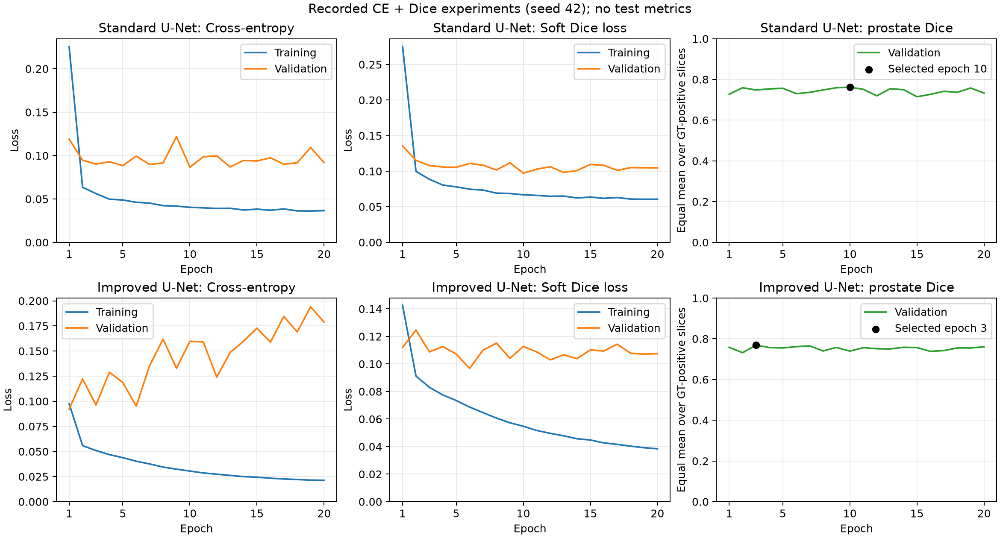

# HipMRI Segmentation with 2D Improved U-Net

## Project summary

This COMP3710 Normal-difficulty project compares a standard 2D U-Net with a 2D adaptation of the Improved U-Net described by Isensee et al. The task is six-class segmentation of HipMRI slices. The engineering question is whether the architecture improves segmentation enough to justify its compute cost and remaining errors.

The final Improved U-Net achieved **prostate test Dice 0.80288**, compared with **0.77929** for the standard U-Net trained with the same CE+Dice loss. Both exceed the assignment target of 0.75. The improved model also produced more false positives on prostate-negative slices and required about 2.96 times the measured GPU inference time per slice. It did not improve every class or remove important failure modes.

The models are educational annotation prototypes. Clinical benefit and reduced human editing time were not measured.

## Data and preprocessing

The shared Rangpur data root is:

```text
/home/groups/comp3710/HipMRI_Study_open/keras_slices_data
```

| Split | Cases | Slices | Case IDs |
|---|---:|---:|---|
| Training | 31 | 11,460 | 004–033 and 035 |
| Validation | 4 | 660 | 036–039 |
| Test | 3 | 540 | 040–042 |

Files are paired by `(case_id, week, slice_id)`, rather than directory order. The audit found no missing pairs, duplicate keys, unexpected filenames, or case overlap between splits. Week 0 is before treatment; weeks 1–7 are weekly treatment acquisitions, as described in the supplied data documentation.

| Label | Class |
|---|---|
| 0 | Background |
| 1 | Body |
| 2 | Bones |
| 3 | Bladder |
| 4 | Rectum |
| 5 | Prostate |

Images are standardized independently using the mean and population standard deviation of the full slice, with a minimum denominator of `1e-8`. This uses no ground-truth mask or statistics from other patients. Masks remain integer labels without normalization or remapping. The loader checks paired shapes, affine agreement, finite values, integer labels, and the label range. Images have shape `[1, H, W]`; masks have shape `[H, W]`. One-hot encoding is created inside the soft Dice loss; cross-entropy receives integer targets.

An initial 93-pair training sample contained only 256 × 128 images. A later full training run exposed this incomplete assumption. The subsequent header audit found 11,400 training pairs at 256 × 128 and 60 at 256 × 144 (case 019, week 1); all 660 validation pairs were 256 × 128. No paired shape mismatch or header read failure was found. `ShapeBatchSampler` groups training slices by shape and shuffles within groups and across batches. Each epoch covers every slice once: 1,432 batches of eight and one batch of four. No resizing, cropping, padding, or sample removal is used. Loader content checks were exercised during the completed training and evaluation runs; this is not an expert audit of annotation correctness.

Images are displayed in stored array orientation. Anatomical directions and the physical meaning of the stored pixel spacing have not been verified. Pixel areas must not be presented as physical areas or distances.


## Models

### Standard U-Net

`UNet2D` uses four max-pooling stages, two padded 3 × 3 convolutions with ReLU per feature block, skip concatenation, and transposed-convolution upsampling. It has one input channel, six output classes, 32 base channels, and **7,759,686 parameters**. It follows the U-Net design [1], with project-specific padding and width rather than an exact reproduction.

### Improved U-Net

`ImprovedUNet2D` is a documented 2D adaptation of [2]. It uses residual context blocks, instance normalization, LeakyReLU with slope 0.01, element-wise dropout of 0.3, stride-2 convolutions for downsampling, and nearest-neighbor upsampling followed by convolution. Encoder widths are 32, 64, 128, 256, and 512. Localization modules combine skips and reduce channels with 1 × 1 convolutions. Three segmentation heads at full, half, and quarter resolution are combined by successive upsampling and summation of logits. One loss is applied to the combined output; there are no separate auxiliary losses.

The model has **12,738,610 parameters**. Both models return raw six-class logits and use `argmax` at inference. The comparison measures the combined architecture changes, not the individual effect of each component. Parameter counts are not matched. Both models process individual slices; the improved model does not add inter-slice or 3D context. Input dimensions must be divisible by 16, and the improved model requires more than one bottleneck pixel for instance normalization.

## Training and evaluation protocol

The architecture comparison used the same splits, normalization, CE+Dice loss, Adam optimizer, learning rate 0.001, batch size 8, seed 42, and 20-epoch budget. Models started from random initialization. No augmentation, learning-rate schedule, mixed precision, or post-processing was used. Shape-grouped sampling used the same seed and epoch schedule. The best checkpoint was selected by validation prostate Dice, not test performance. The earlier pure-CE experiment is retained as a loss comparison.

The combined loss is `CE + soft Dice loss` with weight 1. CE uses all pixels and classes. Soft Dice is averaged over ground-truth-positive slice/class pairs for labels 1–5; background and absent pairs are excluded from that term. CE still penalizes wrong-class predictions on negative slices. An all-background batch has a zero Dice-loss term. This training loss is distinct from the hard-label evaluation metric.

History files retain CE separately. Epoch soft Dice loss is weighted by eligible slice/class counts. `total_batch_mean` is the slice-weighted mean of batch objectives; because its weighting differs, it need not equal epoch CE plus the reported epoch soft Dice loss.

### Primary metric

Following tutor clarification, prostate Dice is calculated separately for every slice whose ground truth contains label 5, then averaged equally across those slices:

```text
Dice(slice) = 2 * intersection / (predicted pixels + ground-truth pixels)
Primary Dice = sum of eligible slice Dice / number of eligible slices
```

Eligible slices with empty predictions score zero. Ground-truth-negative slices are excluded, even when false positives exist. No eligible slices means an unavailable metric, not zero or one. Dice sums and eligible counts are accumulated across batches; batch means or patient means are not averaged to form the primary metric. IoU uses intersection divided by union with the same eligibility rule. The same positive-slice convention is reported explicitly for each of the six classes. Per-case results and negative-slice false positives are separate supplements.

Validation contained 254 prostate-positive and 406 prostate-negative slices. Test contained 195 prostate-positive and 345 prostate-negative slices. Test evaluation used frozen validation-selected checkpoints. Subsequent test analysis and figure selection did not change model settings.

## Verification and development evidence

- Data indexing, case separation, mask preservation, normalization, and batching checks passed. Shape-batch coverage and epoch shuffling checks passed after fixing variable-width handling.
- Synthetic metric checks covered perfect overlap, complete misses, partial overlap, negative slices, no eligible slices, and unequal batch aggregation.
- Loss checks covered gradient direction, near-perfect and wrong predictions, all-background batches, and absent-class exclusion.
- Both model smoke tests passed forward/backward/update checks. The improved model also passed both image widths, active gradients for all three segmentation heads, evaluation repeatability, checkpoint round-trip, and old baseline checkpoint compatibility.
- The standard U-Net overfit three training slices using CE (run 709904): prostate Dice 0.98749 after 400 updates. The improved model overfit the same slices using CE+Dice (run 712761): prostate Dice 1.0 after 400 updates, with close train/eval-mode results. These are pipeline checks, not an architecture comparison or test performance.
- A three-epoch CE trial (709996) verified the full loop. Its best validation Dice was 0.71069. Full training and test jobs subsequently completed successfully.
- The unified evaluator reproduced both prior validation prostate metrics and false-positive totals exactly. Final CSV and JSON results were reconciled by slice, class, and case.


## Validation experiments

The values below use the independent validation inspection for consistent comparison. Small differences from training-log Dice were recorded (less than 0.00003).

| Model / loss | Training run | Selected epoch | Validation prostate Dice | Negative slices with prostate FP |
|---|---|---:|---:|---:|
| Standard U-Net / CE | 710034 | 16 | 0.73026 | 13 / 406 |
| Standard U-Net / CE+Dice | 711775 | 10 | 0.76207 | 40 / 406 |
| Improved U-Net / CE+Dice | 712829 | 3 | 0.76886 | 52 / 406 |

CE+Dice reduced empty predictions on positive validation slices from 18 to 4, but increased negative-slice false positives. The architecture change then reduced empty predictions from 4 to 3 and zero-overlap predictions from 8 to 4. Its validation gain came from the 1–100-pixel target group; the other two area-group means decreased. Area groups were exploratory, not clinical size thresholds.

For the improved model, training CE fell from 0.09754 to 0.02130 while validation CE rose from 0.09214 to 0.17878. The highest validation Dice occurred at epoch 3. This is consistent with overfitting and supports using the saved best checkpoint rather than the last epoch. No extra training was chosen using test results.

### Training curves and measured training budget



The curves are reconstructed from the original 20-epoch CSV logs, not from a new training run. They show training and validation CE and soft Dice losses, plus validation prostate Dice. Training hard Dice was not logged and is not invented. Selected epochs are 10 for standard U-Net and 3 for Improved U-Net.

The standard run recorded 1,871.05 training seconds and 91.08 validation seconds (32.70 minutes combined). The improved run recorded 1,948.78 and 90.35 seconds (33.99 minutes combined). Together, these two comparison runs used about 1.11 hours of measured training/validation loop time. This excludes queueing, setup, checkpoint writing outside the timers, earlier experiments and diagnostic runs; it is not the full project GPU budget.

## Final test results

Test job 713255 completed with exit code 0. Checkpoints were standard U-Net run 711775 epoch 10 and Improved U-Net run 712829 epoch 3. Both passed the prostate Dice target of 0.75. This target alone does not establish full assignment completion or deployment suitability.

## Class results

| Class | Eligible slices | Standard Dice | Improved Dice | Standard IoU | Improved IoU |
|---|---:|---:|---:|---:|---:|
| Background | 540 | 0.99671 | 0.99603 | 0.99345 | 0.99209 |
| Body | 540 | 0.98430 | 0.98448 | 0.96914 | 0.96947 |
| Bones | 540 | 0.91803 | 0.92417 | 0.85275 | 0.86174 |
| Bladder | 401 | 0.94331 | 0.94512 | 0.90197 | 0.90208 |
| Rectum | 220 | 0.82078 | 0.81171 | 0.72021 | 0.70201 |
| Prostate | 195 | 0.77929 | 0.80288 | 0.67599 | 0.69966 |

## Prostate by case

| Case | Eligible slices | Standard Dice | Improved Dice |
|---|---:|---:|---:|
| 40 | 141 | 0.80091 | 0.81509 |
| 41 | 22 | 0.77786 | 0.80564 |
| 42 | 32 | 0.68499 | 0.74719 |

## Prostate target area groups

Exploratory pixel-area groups; not clinical size thresholds.

| GT area | Slices | Standard Dice | Improved Dice | Standard empty / zero overlap | Improved empty / zero overlap |
|---|---:|---:|---:|---:|---:|
| 1-100 | 28 | 0.42486 | 0.48749 | 1 / 2 | 1 / 2 |
| 101-500 | 146 | 0.83149 | 0.85274 | 1 / 1 | 0 / 0 |
| 501+ | 21 | 0.88889 | 0.87680 | 0 / 0 | 0 / 0 |

## Inference cost

A100, float32, batch size 1, 10 warmup forwards per shape and case, three timing repeats. Times below are per-case medians. CPU-cached wall time includes transfers, forward, and argmax; excludes disk reading, normalization, metrics, and saving. GPU time covers forward and argmax. Cases include all available weeks.

| Case | Slices / sessions | Standard GPU seconds | Improved GPU seconds | Standard cached wall seconds | Improved cached wall seconds |
|---|---:|---:|---:|---:|---:|
| 40 | 420 / 7 | 0.9431 | 2.7939 | 1.0226 | 2.8765 |
| 41 | 60 / 1 | 0.1347 | 0.3972 | 0.1456 | 0.4083 |
| 42 | 60 / 1 | 0.1343 | 0.3969 | 0.1454 | 0.4080 |

UNet2D: 7,759,686 parameters; peak allocated inference memory 0.05794 GiB. Weighted GPU time per slice (sum of case medians / 540): 2.245 ms.

ImprovedUNet2D: 12,738,610 parameters; peak allocated inference memory 0.09460 GiB. Weighted GPU time per slice (sum of case medians / 540): 6.644 ms.

## False positives and compute tradeoffs

On the 345 prostate-negative test slices, the standard model produced false positives on 28 slices (8.12%), versus 48 (13.91%) for the improved model. Total false-positive pixels increased from 560 to 1,744. This cost is not captured by the positive-slice Dice score.

| Resource | Standard U-Net + CE+Dice | Improved U-Net + CE+Dice |
|---|---:|---:|
| Parameters | 7,759,686 | 12,738,610 |
| Peak allocated training memory, batch 8 | 0.6884 GiB | 2.2031 GiB |
| Peak reserved training memory | 1.2246 GiB | 3.4199 GiB |
| Peak allocated inference memory, batch 1 | 0.05794 GiB | 0.09460 GiB |
| Weighted GPU inference time per slice | 2.245 ms | 6.644 ms |

Training peak values include the training/validation loop. PyTorch allocated and reserved memory are different measures and are not total GPU process memory. Training and inference memory must not be compared as if they used the same workload. GPU inference time includes forward and argmax, excluding transfer and disk loading. The per-case table above provides the separate CPU-cached wall-time measurement. All timings come from one job with fixed model order and three repeats; no cross-device benchmark is claimed.

## Test failure analysis

### Scope and selection

Five examples were selected after the frozen test evaluation (run 713255) to illustrate different prostate segmentation errors. They span three patients, with three examples from case 42. They are descriptive examples, not a random sample or an estimate of error frequency. No model settings were changed using these examples.

Sources are the saved prediction masks, the five comparison figures, and `selection.json`. Red denotes false-positive pixels and cyan denotes false-negative pixels. Images use stored array orientation; anatomical directions, prostate base/apex identity, and physical distances have not been established. Errors are measured against the supplied labels.

### 1. Complete omission of a small target

Case 42, week 0, slice 40 contains 69 prostate pixels. Both models predict none, giving Dice 0, FP 0, and FN 69. The overlay shows the entire labeled target in cyan, with no predicted region. The improved architecture does not resolve this failure.

The small target provides limited spatial evidence. Loss of fine features during downsampling is a possible explanation, but this example does not establish the cause. An empty prediction must not be treated as evidence that the target is absent.


### 2. Non-empty prediction at the wrong location

Case 42, week 0, slice 9 contains only 8 target pixels. The standard model predicts 19 pixels and the improved model predicts 40. Neither prediction overlaps the target, so both score Dice 0 and FN 8. The red and cyan regions are close but separate in the displayed overlay.

This differs from an empty prediction: a visible prediction can still miss the entire target. For an eight-pixel target, even a small spatial mismatch can remove all overlap. Fine localization remains unreliable in this example; the larger prediction does not recover the target. No distance in millimeters is inferred.


### 3. Under-segmentation of a larger target

Case 42, week 0, slice 16 contains 457 target pixels. Both predictions cover an inner portion while leaving a visible cyan region around parts of the target. The standard model has FN 171 and FP 13, with Dice 0.7566. The improved model has FN 208 and FP 9, with Dice 0.6965.

The improved model reduces false positives slightly but omits more of the target. This shows that a smaller predicted region is not necessarily a better contour. Unclear local boundaries or a learned preference for smaller shapes could contribute, but neither explanation has been tested.


### 4. Over-segmentation despite complete target coverage

Case 41, week 0, slice 39 contains 97 target pixels. Both models cover every target pixel (FN 0), but their predicted regions extend visibly beyond the label. The standard model predicts 340 pixels, including 243 false positives, and scores Dice 0.4439. The improved model predicts 324 pixels, including 227 false positives, and scores Dice 0.4608.

The improvement is small and substantial excess area remains. Complete target coverage alone therefore does not establish boundary accuracy. Similar surrounding appearance is a possible source of confusion, not a confirmed explanation or a diagnosis of the surrounding tissue.


### 5. A false region on a GT-negative slice

Case 40, week 3, slice 33 has no ground-truth prostate pixels. The standard model predicts one pixel, while the improved model produces a visibly compact region of 227 pixels. All predicted pixels are false positives relative to the supplied annotation.

Dice is N/A for this slice under the tutor's positive-slice protocol. It must not be entered as zero or one in the primary average. This example illustrates a risk that the main Dice score does not capture, so negative-slice false-positive counts and areas must be reported separately. The annotation does not support a claim about clinical organ absence.


### Engineering recommendation

The improved model raises test prostate Dice from 0.77929 to 0.80288, but negative slices with prostate false positives increase from 28/345 to 48/345. It also has about 1.64 times as many parameters and takes about 2.96 times the measured GPU inference time per slice. Rectum Dice decreases from 0.82078 to 0.81171. The mean prostate improvement does not remove complete omissions, location errors, or contour errors.

For a resource-limited annotation prototype, the standard U-Net is a reasonable default when speed and fewer false-positive slices matter most. The improved model is an option when higher prostate overlap is the main priority and the extra review and compute costs are acceptable. Actual editing time and user benefit were not measured, so neither model is shown to reduce annotation workload. Both require review of every proposed contour, including slices with empty predictions. These results do not establish suitability for clinical use.

Both networks process each slice independently. Multi-scale 2D features are not inter-slice context, and this experiment does not show whether 3D context would solve the remaining failures. Future studies could investigate adjacent-slice information, fine-resolution features, and uncertainty-based review flags using training/validation data and a new held-out evaluation. These are future hypotheses, not changes to apply after inspecting this test set.

Only three test patients were evaluated, and case 40 contributes 141 of the 195 eligible prostate slices. The selected figures provide qualitative boundary evidence, not a numerical boundary-distance benchmark. No statistical significance, clinical benefit, or verified base/apex localization is claimed.

## Environment and reproduction

Experiments ran on Rangpur using an NVIDIA A100-PCIE-40GB, PyTorch 2.14.1+cu130, and CUDA build 13.0. The environment uses Python 3.11, NumPy, NiBabel, and Matplotlib. The recorded direct package versions are NumPy 2.4.6, NiBabel 5.4.2 and Matplotlib 3.11.2. The run snapshot records torch 2.14.1 and torchvision 0.29.1; the runtime reported PyTorch 2.14.1+cu130. Python was recorded at the 3.11 series level, not an exact patch version. Package snapshots are saved by the job scripts in each run's `environment.txt`. These are observed experiment versions, not a verified installation recipe for other systems. A GPU job used partition/account `comp3710`, one GPU, two CPUs, and `--mem=0` for this cluster's configuration. These Slurm settings are site-specific.

From the project directory on a system with access to the shared data:

```bash
source "$HOME/miniconda3/bin/activate"
conda activate torch
sbatch train_ce_dice.sh
sbatch train_improved.sh
```

Training jobs save source snapshots, configuration, history, best/last checkpoints, and per-class validation results under `runs/`. The improved training job also runs independent validation inspection. New job IDs create new directories; they will not reproduce the historical directory names automatically. Training must start from random weights, not an overfit-check checkpoint.

The equivalent training command for either model, inside an allocated GPU job, is:

```bash
python train.py --model ImprovedUNet2D --loss ce_dice --dice-weight 1.0 \
    --epochs 20 --batch-size 8 --learning-rate 0.001 --seed 42 \
    --output runs/new_improved_experiment
```

Use `--model UNet2D` and a new output directory for the standard model. Output directories must not already exist. The code sets seeds and deterministic cuDNN options, but exact reproducibility across software/hardware versions is not established.

To evaluate newly trained checkpoints, set their actual paths and run inside a GPU allocation:

```bash
python evaluate_models.py \
    --standard runs/ce_dice_711775/results/best.pt \
    --improved runs/improved_712829/results/best.pt \
    --split test --repeats 3 --output runs/new_test_evaluation
```

These example paths identify the reported experiments. Weights are not distributed in Git, so a fresh checkout requires training and replacement of both paths. `--split validate` is available for checking the evaluator before final testing. `predict.py` defaults to validation inspection and supports explicit `--split test` for a frozen-checkpoint test demonstration. It prints prostate metrics and saves three GT-positive prediction/error examples. The split option was added after the reported evaluation; it does not change the frozen results. The unified evaluator provides six-class validation or test metrics and saves prediction masks. Repeated test access must not be used for tuning.

To reproduce the five figures from the stored test predictions, on a CPU compute node:

```bash
python plot_test_failures.py --results runs/eval_test_713255/results \
    --output runs/new_test_failure_figures
```

To demonstrate test inference with the required entry point, inside a GPU allocation:

```bash
python predict.py --checkpoint runs/improved_712829/results/best.pt \
    --split test --output runs/new_test_prediction_demo
```

To regenerate the training curves on a CPU compute node:

```bash
python plot_training_history.py \
    --standard experiment_records/standard_history.csv \
    --improved experiment_records/improved_history.csv \
    --output figures/training_curves.png
```

## Code and evidence map

| File or directory | Purpose |
|---|---|
| `modules.py` | Standard and improved model definitions |
| `dataset.py` | NIfTI pairing, loading, validation, normalization |
| `sampling.py` | Shape-grouped training batches |
| `losses.py` | CE+Dice objective |
| `metrics.py` | Positive-slice Dice/IoU and negative-slice FP counts |
| `train.py` | Training, validation, history, checkpoint selection |
| `predict.py` | Validation or explicit test inspection and prostate plots |
| `plot_training_history.py` | Training curves from recorded CSV histories |
| `evaluate_models.py` | Frozen-checkpoint six-class evaluation and profiling |
| `plot_test_failures.py` | Selected examples from saved predictions |
| `check_*.py`, `overfit_*.py` | Diagnostic checks |
| `*.sh` | Rangpur job entry points |
| `experiment_records/` | Retained reports and compact metric evidence |
| `figures/` | Report figures |
| `runs/` | Local experiment outputs, excluded from Git |

The accompanying records include the loss comparison, architecture comparison, final test tables, and detailed failure analysis. Raw MRI data, complete prediction archives, and model weights must remain outside Git. Commit only the selected report figures and compact records needed to support the report.

## Feasibility review

The one-page feasibility review was prepared and discussed with the tutor, and tutor check-off was completed. Its content is included below; no separate upload of the written review is required. The initial plan and evidence are distinguished from the final project outcomes.

### Initial user need, scope and acceptance criteria

The intended user is an imaging specialist reviewing draft anatomical contours. This educational prototype segments six classes in HipMRI 2D slices, with particular attention to the prostate. It is not intended for clinical deployment. The engineering question is whether Improved U-Net improves difficult boundaries over standard 2D U-Net enough to justify its computing cost.

The initial acceptance criteria were to:

- Maintain patient-level separation and valid image-mask pairing.
- Achieve a prostate test Dice of at least 0.75 and report per-class Dice, IoU and per-patient results.
- Compare both models with the same splits and preprocessing, including analysis of small-target slices.
- Complete training and inference on one A100 40 GB GPU and measure memory use and runtime.
- Analyse three to five real prediction failures with masks and error overlays, and identify cases needing manual review.

Following tutor clarification, prostate Dice is calculated for each slice containing ground-truth prostate label 5, then averaged equally across those slices. Slices without ground-truth prostate pixels are excluded. Eligible slices with no predicted prostate pixels receive a score of zero.

### Initial model choice and course concepts

The proposed main model was 2D Improved U-Net at Normal difficulty, with standard 2D U-Net as the baseline. Relevant course concepts include convolutional features, encoder-decoder networks, skip connections, class imbalance, and Dice/IoU evaluation. The training loss had not yet been selected at the time of the review.

### Evidence available at the review

The supplied splits contained 31 training cases (11,460 slices), four validation cases (660 slices), and three test cases (540 slices). Filename checks found no cross-split case overlap, missing pairs, or duplicate sample keys.

A sample of 93 training pairs had matching 256 x 128 shapes and affine matrices, finite values, and integer labels. The six labels were background, body, bones, bladder, rectum, and prostate. Five slices from one training scan showed no obvious global misalignment. This was a limited sample check, not evidence that every image had the same shape.

The loader passed sample and batch checks. The standard U-Net had 7,759,686 parameters and passed forward, backward, and parameter-update checks on an A100-PCIE-40GB. These checks established basic operability, not segmentation accuracy or convergence.

### Initial risks, resource plan and fallback

The identified risks were class imbalance, small prostate regions, few independent test patients, queue delays, and the 16 GB home-storage quota. The plan kept datasets in shared storage and limited saved checkpoints. Physical spacing needed verification before reporting distances in millimetres.

The planned next steps were a small-subset overfit check, followed by a short training trial to measure time per epoch and peak GPU memory. The total training budget was not yet established. Validation data would guide model selection, while test data would not guide tuning.

If resources were insufficient, the proposed options were a smaller batch size or an assessment of mixed-precision training. If the main model remained unworkable, the fallback was standard U-Net with a tutor discussion about the change in scope and difficulty. These were contingency plans, not claims that these changes were used.

### Final feasibility outcome

The completed data checks, GPU smoke tests, overfit checks, full training runs, and final evaluation establish technical feasibility on the tested A100. The initial data-shape assumption failed and was corrected with shape-grouped batches without dropping slices. Both models exceeded the planned prostate test Dice threshold: 0.7793 for standard U-Net with CE + Dice and 0.8029 for Improved U-Net. Five test failure examples are analysed above. Measured resource costs and the final training settings are reported in the experiment sections.

The main remaining limitations are few independent patients, imperfect contours, negative-slice false positives, and uncertain physical spatial metadata. Meeting the Dice target does not establish clinical suitability or consistent improvement on every class or slice.

## Submission status

- Feasibility review: included in this README; tutor discussion and check-off completed.
- Verify all referenced source files, selected figures, and experiment records are committed on `topic-recognition`.
- GitHub pull request opened: [PR #146](https://github.com/shakes76/PatternAnalysis-2026/pull/146).
- Export the final README as a PDF and complete the Turnitin submission.
- Inspect the exported PDF for readable tables and figures.
- Address the required code review and record responses and changes.

## Data acknowledgement and references

Data were provided by HipMRI Study. Data use follows the supplied non-commercial terms, including no attempts to identify or contact participants and proper acknowledgement. The data provider does not guarantee annotation correctness.

1. Ronneberger et al. (2015). U-Net: Convolutional Networks for Biomedical Image Segmentation. https://arxiv.org/abs/1505.04597
2. Isensee et al. (2018). Brain Tumor Segmentation and Radiomics Survival Prediction: Contribution to the BRATS 2017 Challenge. https://arxiv.org/abs/1802.10508
3. HipMRI dataset: Labelled weekly MR images of the male pelvis. https://doi.org/10.25919/45t8-p065
4. Dowling et al. (2015). Automatic Substitute Computed Tomography Generation and Contouring for Magnetic Resonance Imaging (MRI)-Alone External Beam Radiation Therapy From Standard MRI Sequences. https://doi.org/10.1016/j.ijrobp.2015.08.045

## Artificial Intelligence Usage Disclosure

OpenAI ChatGPT/Codex assisted with interpreting requirements, Rangpur setup, Slurm troubleshooting, drafting and modifying model/data/loss/training/evaluation code, designing diagnostic checks, analysing logs and supplied metrics, creating plots, and drafting this report. AI assistance extended beyond language editing.

Commands and GPU experiments were executed by the student on Rangpur. Reported outputs, CSV/JSON metrics, and selected images were supplied for review. AI-assisted checks included source inspection, syntax checks, metric reconciliation, and visual interpretation. A smoke test is not evidence of generalization. Some implementation choices and explanations were AI-proposed; plausible failure causes are labelled as hypotheses rather than established facts.

The student remains responsible for understanding the submitted code, checking the final report and references, meeting course AI-use rules, and confirming required submissions and tutor review. Model predictions were not replaced by generated images. No claims of independent manual authorship or unverified course approval are made.

## Final inference entry-point verification

After adding explicit test-split support to `predict.py`, job 719450
loaded the frozen Improved U-Net checkpoint from epoch 3 and processed
all 540 test slices. The 195 eligible slices produced prostate Dice
0.8028843775392076 and IoU 0.6996586435434642. The negative-slice
false-positive counts were 48 slices and 1,744 pixels. These results
exactly matched the original unified test evaluation. This was an
entry-point verification; no retraining, model selection, or parameter
tuning was performed.
