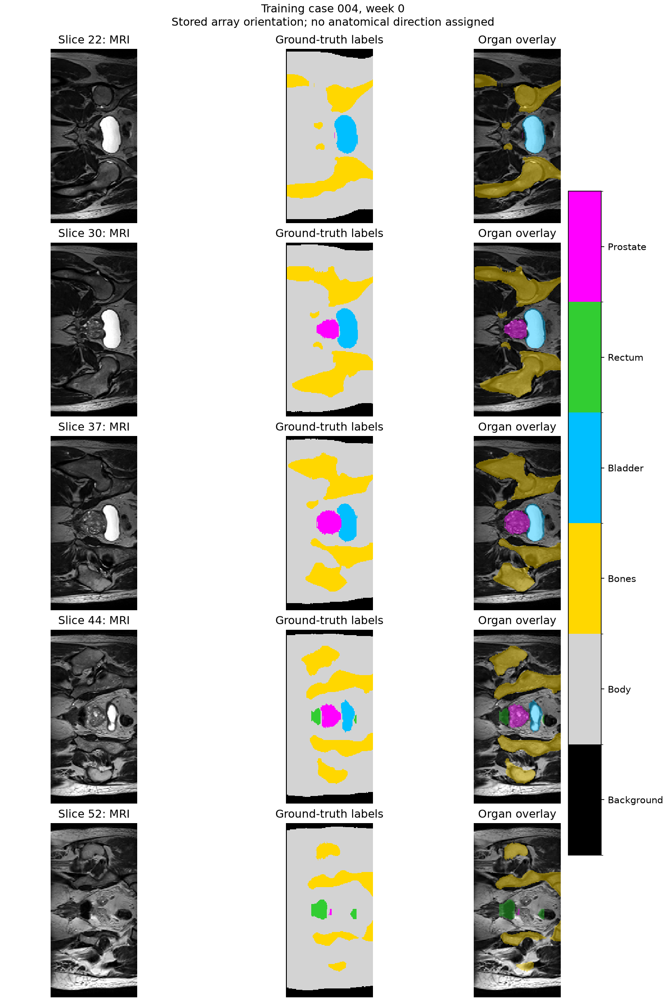
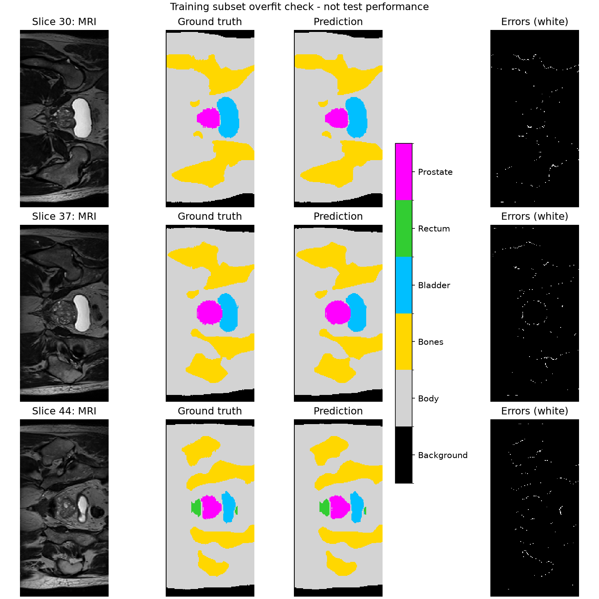
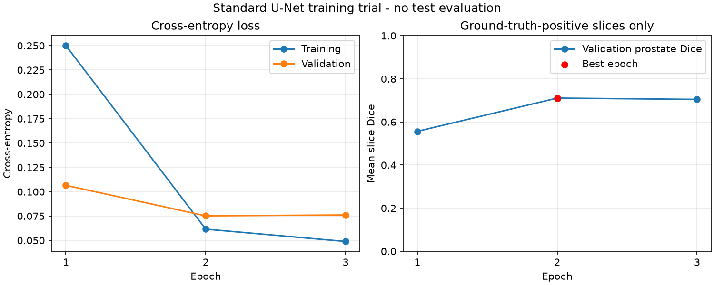

# HipMRI Segmentation with 2D Improved U-Net

## Project Scope

This project studies multi-class segmentation of HipMRI 2D images.
The planned baseline is standard 2D U-Net, and the main model is
2D Improved U-Net at COMP3710 Normal difficulty.

The study will examine whether the improved model produces better
boundaries in difficult regions and whether the gains justify its
computing cost. The target prostate test Dice is at least 0.75.

No model has been implemented or trained yet.

## Verified Environment

- Platform: Rangpur.
- GPU: NVIDIA A100-PCIE-40GB.
- PyTorch: 2.14.1+cu130.
- PyTorch CUDA build: 13.0.
- CUDA availability and a small GPU matrix multiplication test passed.
- The Slurm test job completed with exit code 0.
- The successful test used partition `comp3710`, account `comp3710`,
  one GPU, and `--mem=0`.

Basic GPU computation has been verified. Full training speed and peak
memory use have not been measured. Memory settings need review before
full training.

## Data Audit

Data location on Rangpur:

`/home/groups/comp3710/HipMRI_Study_open/keras_slices_data`

| Split | Number of Cases | Image-Mask Pairs |
|---|---:|---:|
| Training | 31 | 11,460 |
| Validation | 4 | 660 |
| Test | 3 | 540 |
| Total | 38 | 12,660 |

There is no overlap between splits based on case IDs in filenames.
Images and masks match by case, week, and slice number. No missing
pairs, duplicate keys, or unexpected filenames were found.

A sample of 93 training pairs had matching shapes of 256 x 128.
No shape or affine mismatch, non-finite values, or non-integer mask
values were found in this sample. Full content validation is pending.

The test set contains only three cases. Final evaluation should
include per-case results rather than treating slices as independent
patients.

## Label Definitions

The original dataset's `BriefDataDescription.txt` defines:

| Value | Class |
|---|---|
| 0 | Background |
| 1 | Body |
| 2 | Bones |
| 3 | Bladder |
| 4 | Rectum |
| 5 | Prostate |

Week 0 was acquired before treatment. Weeks 1-7 were acquired weekly
during treatment.

Labels 0-5 were observed in the sampled course 2D data. Visual checks
of alignment and consistency with the original label definitions
are pending. The physical meaning of the stored pixel spacing has
not yet been verified.

## Planned Evaluation

- Per-class Dice and IoU.
- Baseline comparison using the same patient splits.
- Parameter count, peak GPU memory, and per-case inference time.
- Visual analysis of 3-5 representative failure cases.
- An engineering recommendation based on measured results.

## Feasibility Review Status

The one-page feasibility review and tutor check-off are pending.
These preliminary checks do not replace that requirement.

## Data Acknowledgement and References

Data were provided by HipMRI Study.

- Dataset: Labelled weekly MR images of the male pelvis.
  https://doi.org/10.25919/45t8-p065
- Dowling et al. (2015), Automatic Substitute Computed Tomography
  Generation and Contouring for Magnetic Resonance Imaging (MRI)-Alone
  External Beam Radiation Therapy From Standard MRI Sequences.
  https://doi.org/10.1016/j.ijrobp.2015.08.045

Data use must follow the supplied terms, including non-commercial use,
no attempts to identify or contact participants, and proper
acknowledgement and citation.

Datasets and model weights will not be committed to this repository.

## Artificial Intelligence Usage Disclosure

OpenAI ChatGPT/Codex assisted with understanding the assignment,
setting up Rangpur, diagnosing Slurm settings, drafting preliminary
data-check scripts, and preparing documentation.

Environment and data-check scripts were run on Rangpur and their
outputs were inspected. Model implementation and training have not
started. This disclosure will be updated as the project develops.

## Initial Visual Inspection

The figure below shows training case 004 at week 0. Of its 60 slices,
31 contain prostate label 5. Slices 22, 30, 37, 44, and 52 were selected
across the prostate-positive slice range.



The five displayed pairs show no obvious global displacement or flip.
This is a limited visual check, not confirmation of all cases or
fine boundary accuracy.

The prostate label occupies a small region in slices 22 and 52 and
larger regions in the selected intermediate slices. This supports
including small-target slices in later performance analysis.

Images are shown in stored array orientation. Anatomical directions
have not been assigned. These are ground-truth previews, not model
predictions or model failure cases.

To reproduce the figure in an environment with NumPy, NiBabel, and
Matplotlib installed, run from this project directory:

```bash
python visualize_data.py
```

## Dataset Loader

`dataset.py` pairs images and masks using case, week, and slice IDs.
It preserves the supplied training, validation, and test splits.

Each sample contains:
- `image`: float32 tensor with shape [1, 256, 128].
- `mask`: int64 tensor with shape [256, 128].
- `case_id`, `week`, and `slice_id`: sample identifiers.

Images are standardized using the mean and population standard
deviation of each full slice, with a minimum denominator of 1e-8.
Masks are not normalized or remapped.

The loader checks shapes, affine alignment, finite values, integer
mask values, and the allowed label range of 0-5.

File indexing reproduced the audited split counts and found no
cross-split case overlap. A loading smoke test verified one training
sample and a batch of four samples. The first sample's mask matched
the original file exactly, and its normalized image had approximately
zero mean and unit standard deviation.

These checks do not constitute full dataset validation. Data
augmentation is not implemented yet.

### AI Assistance Update

ChatGPT/Codex assisted with drafting the dataset loader and its
smoke-test commands. The commands were executed on Rangpur, and the
reported checks passed. Full dataset validation and model training
remain pending.

## Standard 2D U-Net Baseline

`modules.py` implements a standard U-Net baseline with four
downsampling stages, skip connections, transposed-convolution
upsampling, and two padded 3x3 convolutions per feature block.

The configuration uses one input channel, six output classes,
and 32 base channels. It contains 7,759,686 trainable parameters.
The output contains raw logits; softmax is not applied in the model.

Reference: Ronneberger et al. (2015), U-Net: Convolutional Networks
for Biomedical Image Segmentation.
https://arxiv.org/abs/1505.04597

This baseline uses padded convolutions and a base width of 32.
It is not an exact reproduction of every original paper setting
and is not the project's planned Improved U-Net model.

### Model Smoke Test

`check_model.py` was run on an NVIDIA A100-PCIE-40GB through
`check_model.sh`.

- Input shape: [2, 1, 256, 128].
- Output shape: [2, 6, 256, 128].
- Initial cross-entropy: approximately 1.6542.
- All trainable parameters received finite gradients.
- The output-layer weights changed after one optimizer step.
- Model parameters remained finite after the update.

This verifies a forward pass, backward pass, and parameter update.
It does not establish segmentation accuracy, convergence, or
generalization. The two samples came from the training split.

ChatGPT/Codex assisted with drafting the baseline and smoke-test
scripts. The test was executed on Rangpur and its output was inspected.

## Prostate Dice Evaluation Protocol

Following tutor clarification, prostate test Dice will be calculated
for each slice whose ground-truth mask contains prostate label 5,
then averaged equally across those slices. Slices without ground-truth
prostate pixels will be excluded from this metric. Eligible slices
with no predicted prostate pixels will receive a Dice score of zero.

Across batches, Dice sums and eligible slice counts are accumulated
before computing the final mean. Batch means and patient means are
not averaged to obtain the primary score. If no slices are eligible,
the metric is undefined and reported as unavailable.

Per-patient results and false positives on ground-truth-negative
slices will be reported separately.

Synthetic checks in check_metrics.py verified perfect predictions,
complete misses, partial overlap, excluded negative slices, and
aggregation across unequal batches.

## Small Training Subset Overfit Check

Standard U-Net was trained from random initialization on training
case 004, week 0, slices 30, 37, and 44. The run used seed 42,
cross-entropy loss, Adam with a learning rate of 0.001, and 400
updates on the same three-slice batch without augmentation.

Cross-entropy decreased from 1.801918 to 0.014945.
Final mean prostate Dice was 0.987492 across three eligible slices.
Rectum Dice was 0.968280 on its single eligible slice.

Visual inspection showed close agreement with the training masks.
Remaining errors were mainly near boundaries. The error panel marks
all misclassified pixels and does not separate false positives from
false negatives.



The metric history is saved in
experiment_records/overfit_709904_history.csv.

The script reported 4.33 seconds for its training and evaluation loop
and 0.294 GiB peak PyTorch allocated GPU memory. These measurements
exclude initial data loading and final output generation. They do
not represent full-dataset training time or total GPU process memory.

This diagnostic supports basic learning-pipeline functionality.
It is not validation or test performance and does not establish the
assignment's test Dice target. The final training loss remains to
be selected using training and validation evidence.

ChatGPT/Codex assisted with drafting the metric and overfit-check
scripts and interpreting their outputs. Metric checks and the
overfit experiment were executed on Rangpur, and the prediction
figure was visually inspected.

## Full Training Trial and Variable Image Sizes

The first full training attempt stopped because the loader assumed
all images had shape 256 x 128. That assumption came from a limited
93-pair sample and was not valid for the full training set.

A subsequent header audit found:
- Training: 11,400 pairs at 256 x 128 and 60 pairs at 256 x 144.
- Validation: 660 pairs at 256 x 128.
- No image-mask shape mismatches or header read failures.

The loader now accepts paired 2D shapes divisible by 16.
The previously documented [1, 256, 128] image shape describes the
initial sample; the general sample format is [1, H, W], with masks
of shape [H, W].

ShapeBatchSampler groups training samples by shape, shuffles samples
within each group, and shuffles batch order each epoch. No resizing,
cropping, padding, or sample removal is used. Coverage checks confirmed
11,460 unique samples per epoch, in 1,432 batches of eight and one
batch of four. Both observed shapes loaded successfully.

### Three-Epoch Baseline Trial

Run: train_trial_709996.

The standard U-Net was trained from random initialization using
cross-entropy, Adam, learning rate 0.001, batch size 8, and seed 42.
No augmentation or mixed precision was used. Validation did not
update model parameters, and no test data were evaluated.

| Epoch | Training CE | Validation CE | Validation prostate Dice |
|---|---:|---:|---:|
| 1 | 0.250125 | 0.106568 | 0.556327 |
| 2 | 0.061566 | 0.075206 | 0.710694 |
| 3 | 0.048912 | 0.076103 | 0.704624 |

Epoch 2 produced the highest validation prostate Dice and was saved
as best.pt. The last checkpoint corresponds to epoch 3.

Each validation evaluation included 254 prostate-positive slices and
excluded 406 prostate-negative slices from the primary Dice metric.
The numbers of negative slices with prostate false positives were
4, 9, and 7 across epochs 1, 2, and 3.

The three training and validation loops took approximately 289 seconds
in total, excluding initialization, checkpoint saving, and queue time.
Recent epochs required about 99 seconds each for training plus
validation. Peak PyTorch allocated and reserved GPU memory were
approximately 0.688 GiB and 1.225 GiB, respectively. These are not
measurements of total GPU process memory.



Configuration, metric history, and per-class validation summaries
are stored in experiment_records/train_trial_709996/.

This trial establishes full training-loop operability and an initial
compute estimate. It does not establish test performance or final
convergence. The small validation decrease at epoch 3 alone is not
sufficient evidence of overfitting.

ChatGPT/Codex assisted with the training scripts, shape-handling fix,
checks, and experiment documentation. Commands were executed on
Rangpur and their reported outputs were inspected.
