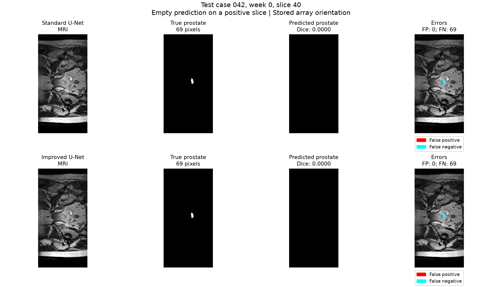
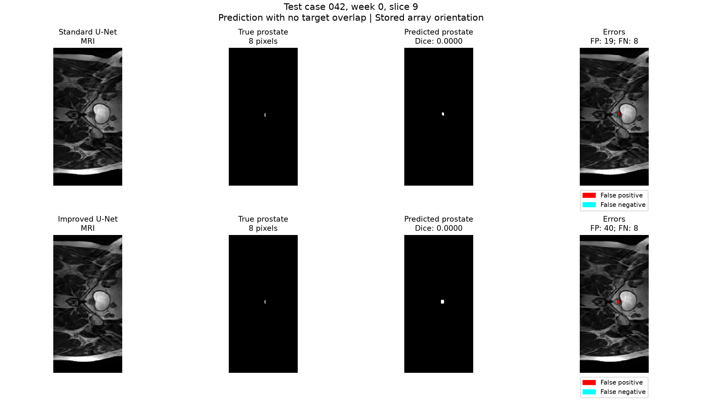
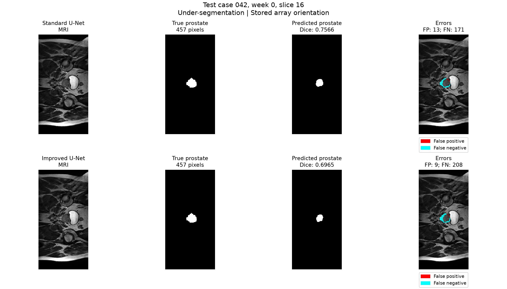
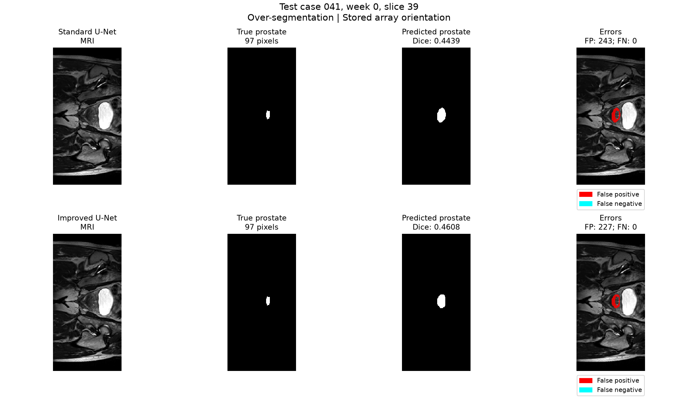
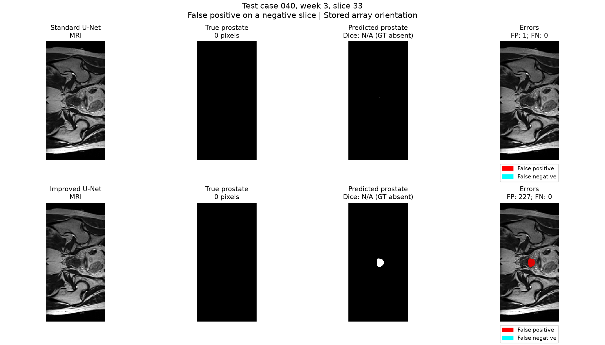

# Test failure analysis and engineering recommendation

## Scope and selection

Five examples were selected after the frozen test evaluation (run 713255) to illustrate different prostate segmentation errors. They span three patients, with three examples from case 42. They are descriptive examples, not a random sample or an estimate of error frequency. No model settings were changed using these examples.

Sources are the saved prediction masks, the five comparison figures, and `selection.json`. Red denotes false-positive pixels and cyan denotes false-negative pixels. Images use stored array orientation; anatomical directions, prostate base/apex identity, and physical distances have not been established. Errors are measured against the supplied labels.

## 1. Complete omission of a small target

Case 42, week 0, slice 40 contains 69 prostate pixels. Both models predict none, giving Dice 0, FP 0, and FN 69. The overlay shows the entire labeled target in cyan, with no predicted region. The improved architecture does not resolve this failure.

The small target provides limited spatial evidence. Loss of fine features during downsampling is a possible explanation, but this example does not establish the cause. An empty prediction must not be treated as evidence that the target is absent.

## 2. Non-empty prediction at the wrong location

Case 42, week 0, slice 9 contains only 8 target pixels. The standard model predicts 19 pixels and the improved model predicts 40. Neither prediction overlaps the target, so both score Dice 0 and FN 8. The red and cyan regions are close but separate in the displayed overlay.

This differs from an empty prediction: a visible prediction can still miss the entire target. For an eight-pixel target, even a small spatial mismatch can remove all overlap. Fine localization remains unreliable in this example; the larger prediction does not recover the target. No distance in millimeters is inferred.

## 3. Under-segmentation of a larger target

Case 42, week 0, slice 16 contains 457 target pixels. Both predictions cover an inner portion while leaving a visible cyan region around parts of the target. The standard model has FN 171 and FP 13, with Dice 0.7566. The improved model has FN 208 and FP 9, with Dice 0.6965.

The improved model reduces false positives slightly but omits more of the target. This shows that a smaller predicted region is not necessarily a better contour. Unclear local boundaries or a learned preference for smaller shapes could contribute, but neither explanation has been tested.

## 4. Over-segmentation despite complete target coverage

Case 41, week 0, slice 39 contains 97 target pixels. Both models cover every target pixel (FN 0), but their predicted regions extend visibly beyond the label. The standard model predicts 340 pixels, including 243 false positives, and scores Dice 0.4439. The improved model predicts 324 pixels, including 227 false positives, and scores Dice 0.4608.

The improvement is small and substantial excess area remains. Complete target coverage alone therefore does not establish boundary accuracy. Similar surrounding appearance is a possible source of confusion, not a confirmed explanation or a diagnosis of the surrounding tissue.

## 5. A false region on a GT-negative slice

Case 40, week 3, slice 33 has no ground-truth prostate pixels. The standard model predicts one pixel, while the improved model produces a visibly compact region of 227 pixels. All predicted pixels are false positives relative to the supplied annotation.

Dice is N/A for this slice under the tutor's positive-slice protocol. It must not be entered as zero or one in the primary average. This example illustrates a risk that the main Dice score does not capture, so negative-slice false-positive counts and areas must be reported separately. The annotation does not support a claim about clinical organ absence.

## Engineering recommendation

The improved model raises test prostate Dice from 0.77929 to 0.80288, but negative slices with prostate false positives increase from 28/345 to 48/345. It also has about 1.64 times as many parameters and takes about 2.96 times the measured GPU inference time per slice. Rectum Dice decreases from 0.82078 to 0.81171. The mean prostate improvement does not remove complete omissions, location errors, or contour errors.

For a resource-limited annotation prototype, the standard U-Net is a reasonable default when speed and fewer false-positive slices matter most. The improved model is an option when higher prostate overlap is the main priority and the extra review and compute costs are acceptable. Actual editing time and user benefit were not measured, so neither model is shown to reduce annotation workload. Both require review of every proposed contour, including slices with empty predictions. These results do not establish suitability for clinical use.

Both networks process each slice independently. Multi-scale 2D features are not inter-slice context, and this experiment does not show whether 3D context would solve the remaining failures. Future studies could investigate adjacent-slice information, fine-resolution features, and uncertainty-based review flags using training/validation data and a new held-out evaluation. These are future hypotheses, not changes to apply after inspecting this test set.

Only three test patients were evaluated, and case 40 contributes 141 of the 195 eligible prostate slices. The selected figures provide qualitative boundary evidence, not a numerical boundary-distance benchmark. No statistical significance, clinical benefit, or verified base/apex localization is claimed.
